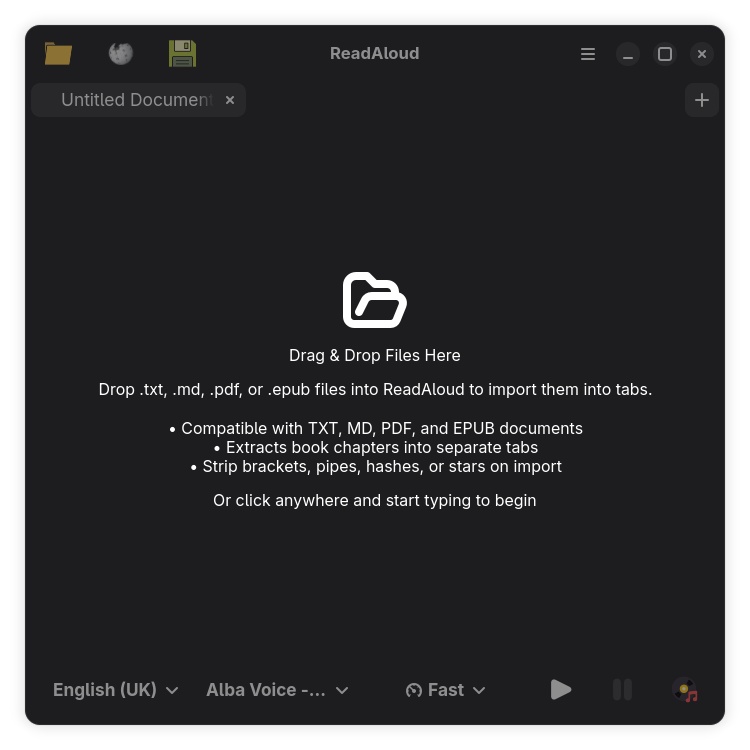
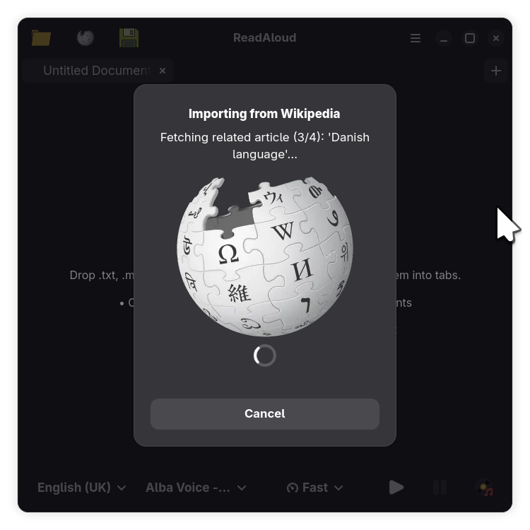

# ReadAloud

<p align="center">
  
</p>

<p align="center">
  <strong>An elegant, private, offline Text-to-Speech reader for Windows and Linux (GNOME, KDE Plasma & more).</strong>
</p>

<p align="center">
  <a href="https://github.com/Zackarious/ReadAloud/releases/latest"></a>
  <a href="https://flathub.org/apps/im.zackarious.ReadAloud"></a>
</p>

<p align="center">
  
  
  
  
  
  
  
</p>

---

**ReadAloud** is a modern, privacy-focused, cross-platform text-to-speech desktop application crafted with GTK4 and Libadwaita. Built for both **Microsoft Windows (10/11)** and **Linux** (including **GNOME**, **KDE Plasma**, Cinnamon, MATE, and XFCE), ReadAloud delivers a native, responsive experience across operating systems and desktop environments. Powered by the high-performance Piper neural speech engine, ReadAloud transforms your written text into rich, natural-sounding audio across diverse voices, accents, pitches, and speeds—complete with synchronized word highlighting, intelligent sentence segmentation, seamless playback controls, preset demos, and voice-optimized audio export.

Unlike conventional cloud-based voice assistants and commercial speech tools, ReadAloud is completely offline. Every syllable is synthesized locally on your own machine using efficient on-device neural models. ReadAloud requires zero internet connection, contains no telemetry, and transmits no data to external servers or third parties. Your personal documents, confidential manuscripts, private notes, and generated recordings remain entirely private, secure, and under your absolute personal control at all times.

ReadAloud is proud to be free and open-source software, licensed under the GNU General Public License v3.0. There are no subscriptions, no recurring fees, no locked paywalls, and no artificial daily usage limits. Transparent by design, the entire source code is openly audited and maintained by the community on GitHub at [https://github.com/Zackarious/ReadAloud](https://github.com/Zackarious/ReadAloud). Whether you are proofreading drafts, studying long articles, creating audio notes, or enhancing accessibility on Windows or Linux, ReadAloud offers an ethical, dependable, and always-accessible speech companion that forever puts your personal privacy and freedom first.

---

## 📸 Screenshots & Feature Walkthrough

### 1. Document Importer & Dropzone
<p align="center">
  
</p>

- **Multi-Format Document Dropzone**: Seamlessly drag and drop `.txt`, `.md`, `.pdf`, or `.epub` files directly into ReadAloud to import them into working tabs.
- **Smart Book Chapter Extraction**: Automatically breaks EPUB and multi-chapter documents into distinct, navigable tabs.
- **Syntax & Symbol Cleansing**: Automatically strips distracting brackets, pipes, markdown hashes, and asterisks so the Piper neural speech engine reads pure, natural language.
- **Adaptive Window Controls**: Features standardized `:minimize,maximize,close` window controls and dedicated headerbar buttons for instant one-click actions across all desktop environments.

---

### 2. Direct Wikipedia Article Importer
<p align="center">
  
</p>

- **One-Click Quick Access**: Open the Wikipedia Importer instantly from the headerbar globe button or the Tools menu (`win.import-wikipedia`).
- **Topic or URL Import**: Enter any article topic or paste full Wikipedia URLs—ReadAloud scrapes and cleans the content locally for offline listening.
- **Multi-Tab Related Article Extraction**: Automatically discovers internal related `/wiki/...` reference links and imports up to 10 related topics into separate sequential tabs.
- **Wikimedia Foundation Support**: Features a non-intrusive donation callout card encouraging direct support for free, open global knowledge.

---

### 3. Live Autocomplete Search with Instant Previews
<p align="center">
  
</p>

- **Official REST API Autocomplete**: Real-time debounced search backed by Wikipedia's official REST Search API, returning exact matches as you type.
- **Rich Visual Cards**: Displays article thumbnail previews, bold headings, and descriptive captions matching Wikipedia's website design.
- **In-Memory Thumbnail Caching**: Thread-safe in-memory image caching eliminates redundant network requests and ensures instant, flicker-free re-querying.
- **Keyboard-First Navigation**: Smoothly navigate down into suggestion cards with `Down Arrow`, hit `Enter` to import, or press `Escape` to dismiss.

---

### 4. Non-Blocking Asynchronous Fetching HUD
<p align="center">
  
</p>

- **Real-Time Step Updates**: Translucent progress modal providing live status updates (e.g. `Fetching related article (3/4): 'Danish language'...`).
- **Threaded Worker Processing**: All network fetching and HTML/markdown parsing run on background worker threads, keeping the application UI fluid and responsive.
- **Instant Safe Cancellation**: Cancel multi-article scraping at any moment without freezing the interface or discarding previously loaded tabs.

---

### 5. Synchronized Speech Playback & Word Highlighting
<p align="center">
  
</p>

- **Synchronized Real-Time Word Highlighting**: High-contrast, dynamic highlighting tracks every spoken word in real-time and auto-scrolls to keep active text in view.
- **Intelligent Sentence Segmentation**: Smooths PDF multi-column line breaks and joins hyphenated words, while guarding abbreviations (`Dr.`, `Mr.`, `e.g.`) and numerical values from premature pauses.
- **Automatic Paragraph Gap Separation**: Enforces clean `\n\n` empty line gaps between paragraphs, providing generous vertical separation that makes long articles effortless to follow during audio synthesis.
- **Complete Audio Control Deck**: Seamlessly switch voices (e.g. `Alba Voice - Medium quality`), adjust calibrated speech speeds (`Normal`, `Fast`, `Super Fast`), or export spoken-word audio to compressed MP3, OGG, FLAC, or uncompressed WAV.

---

## ✨ Features

- 🖥️ **Cross-Platform & Multi-Desktop**: Native experience on **Microsoft Windows (10/11)** and **Linux** across **GNOME**, **KDE Plasma**, Cinnamon, MATE, and XFCE with adaptive dark/light system theme matching.
- 🔒 **100% Offline & Private**: Text synthesis is performed entirely on your machine using local ONNX neural models.
- 🗣️ **Bundled Neural Voices**: Includes 35 natural-sounding voices across English and multilingual accents with multiple voice actors, qualities (low, medium, high), and styles.
- 📄 **Intelligent Sentence Segmentation**: Smoothly un-breaks PDF and multi-column line breaks, stitches hyphenated words, and safeguards abbreviations and numerical values from premature pauses.
- ⭐ **Preset Voice Demos ("Run Demo")**: Instant 1-click test presets showcasing diverse neural voices, speeds, and pitches with overwrite warning protection.
- ⏳ **Loading HUD with Real-Time Countdown**: Sleek translucent HUD displaying a progress bar and estimated time remaining countdown during speech generation.
- 🎯 **Real-Time Word Highlighting**: Synchronized word-by-word visual highlight that smoothly tracks speech progression and automatically keeps text in view.
- ⏯️ **Complete Playback Controls**: Dedicated Play, Pause, Resume, and Stop controls with clean audio state transitions.
- 📍 **Read from Cursor or Selection**: Start listening from your current cursor location or selected text passage without needing to start from the beginning.
- 💾 **Multi-Format Audio Export**:
  - **MP3 (Voice-Optimized 64 kbps)**: Delivers crystal clear spoken-word audio with ~95% reduced file size.
  - **MP3 (128 kbps, 192 kbps, 256 kbps, 320 kbps)**: For standard to broadcast-grade fidelity.
  - **WAV**: Uncompressed 16-bit PCM audio.
  - **OGG Vorbis**: Open standard compressed audio.
  - **FLAC**: Lossless studio-grade compression.
- ⚡ **Simplified 3-Choice Speed Settings**: Easily choose between Normal, Fast, and Super Fast speeds, custom-calibrated across all 35 neural voice models with keyboard shortcut navigation (`Ctrl + Up` / `Ctrl + Down`).
- 🔍 **Dynamic Text Zoom**: Scale editor font from 70% to 1000% via shortcuts (`Ctrl +`, `Ctrl -`, `Ctrl 0`) or `Ctrl` + Mouse Wheel.
- 📜 **In-App Change Logs**: Browse version history and feature documentation directly within the application.

### 🎙️ Voice Quality Levels & Multi-Speaker Models

#### Quality
Voices are trained at one of 4 "quality" levels:
- **`x_low`** — 16Khz audio, 5-7M params
- **`low`** — 16Khz audio, 15-20M params
- **`medium`** — 22.05Khz audio, 15-20M params
- **`high`** — 22.05Khz audio, 28-32M params

#### Multi-Speaker
Some voices contain multiple speakers, which captures the style of multiple people within a single model.
Multi-speaker models can quickly switch between different speakers, but the quality of an individual speaker may be less than a single speaker model.

---

## ⌨️ Keyboard Shortcuts

| Action | Shortcut |
| :--- | :--- |
| **Play / Pause** | `Ctrl + P` / `Space` / `F5` |
| **Stop Playback** | `Escape` |
| **Save Audio to File** | `Ctrl + E` |
| **Increase Speed (+0.1)** | `Ctrl + Up` |
| **Decrease Speed (-0.1)** | `Ctrl + Down` |
| **Open Text File** | `Ctrl + O` |
| **Save Text to File** | `Ctrl + S` |
| **New Document Tab** | `Ctrl + T` |
| **Close Active Tab** | `Ctrl + W` |
| **Zoom In** | `Ctrl + +` / `Ctrl + =` / `Ctrl + Scroll Up` |
| **Zoom Out** | `Ctrl + -` / `Ctrl + Scroll Down` |
| **Reset Zoom (100%)** | `Ctrl + 0` |
| **Keyboard Shortcuts Help** | `Ctrl + ?` |
| **Quit Application** | `Ctrl + Q` |

---

## 💻 System & Software Requirements

ReadAloud runs fully offline using on-device Piper neural speech models and ONNX Runtime. Below are the hardware and operating system requirements:

### Minimum Requirements (Basic / Normal Voice Playback)
*Suitable for real-time speech playback with `medium`, `low`, and `x_low` voice models.*

| Component | Minimum Specification |
| :--- | :--- |
| **Processor** | 1.6 GHz or faster, 2-core processor (x86-64, ARM64, or Apple Silicon with SSE4.2 / NEON) |
| **Operating System** | • **Windows**: Windows 11, Windows Server 2025, or Windows Server 2022 *(Note: Microsoft official consumer support for Windows 10 ended in October 2025, though ReadAloud continues to run with MSVC 2022 runtime)*<br/>• **Linux**: Ubuntu 22.04 LTS+, Debian 12+, Fedora 38+, Arch Linux with GTK 4.6+ & Libadwaita 1.0+<br/>• **macOS**: macOS 12 (Monterey) or later |
| **Memory (RAM)** | 4 GB RAM (or 2 GB minimum available system memory) |
| **Hard Disk Space** | 4 GB of available storage space for application executable, GTK4 runtime, and pre-bundled 35 offline neural voice models |
| **Display** | 1280 × 768 minimum screen resolution |
| **Graphics Card & Drivers** | DirectX 11 / OpenGL 3.3 capable GPU (Intel HD Graphics 4000+, AMD Radeon R5/HD 7000+, NVIDIA GeForce 400 series or newer with standard WDDM 1.2+ drivers; Mesa llvmpipe software rasterizer supported as fallback) |
| **Audio Output** | Standard audio output device, sound card, or headphone jack (DirectSound / WASAPI on Windows, PulseAudio / PipeWire / ALSA on Linux, CoreAudio on macOS) |

### Recommended Requirements (High-Quality Voices & Batch Synthesis)
*Recommended for high-fidelity `high` quality voice models (28–32M parameters), instant book chapter audio rendering, and fast multi-tab playback.*

| Component | Recommended Specification |
| :--- | :--- |
| **Processor** | 2.5 GHz or faster quad-core (4 cores / 8 threads) or higher (Intel Core i5/i7 8th Gen+, AMD Ryzen 3000+, Snapdragon X Elite, Apple Silicon M1/M2/M3/M4) with AVX2 / FMA instruction support |
| **Operating System** | • **Windows**: Windows 11 64-bit (23H2 or newer), Windows Server 2025<br/>• **Linux**: Ubuntu 24.04 LTS+, Fedora 40+<br/>• **macOS**: macOS 14 (Sonoma) or newer |
| **Memory (RAM)** | 8 GB RAM or higher for rapid multi-tab processing and uncompressed high-fidelity audio buffers |
| **Hard Disk Space** | 8 GB of available space on a solid-state drive (NVMe SSD recommended for instant model loading and audio WAV/MP3 rendering) |
| **Display** | 1920 × 1080 (Full HD) or higher resolution with 100% or 125% DPI scaling |
| **Graphics Card & Drivers** | Dedicated or modern integrated GPU with Direct3D 12 / Vulkan / Metal support:<br/>• **NVIDIA**: GeForce GTX 1050 / RTX 2060 or newer (GeForce Game Ready / Studio Driver 535.xx or later)<br/>• **AMD**: Radeon RX 5000 / 6000 series or newer (AMD Software: Adrenalin Edition 23.x or later)<br/>• **Intel**: Intel Iris Xe Graphics, Arc A-Series, or UHD 630+ (Intel Graphics Driver 31.0.101.4000 or newer)<br/>• **Apple**: Apple Silicon Integrated GPU (M1, M2, M3, M4 with Metal 3) |
| **Audio Output** | 24-bit / 48kHz or 96kHz low-latency stereo output device or USB DAC |

---

## 📦 Installation & Downloads

Official releases are published on the **[GitHub Releases Page](https://github.com/Zackarious/ReadAloud/releases/latest)**.

> [!NOTE]
> **Multi-Volume Split File Downloads**:
> Because ReadAloud pre-bundles 35 offline neural voice models and full runtime engines (~2.4 GB uncompressed), large packages are split into 1800 MB volumes (`.001`, `.002`) to strictly adhere to GitHub's 2.0 GiB release asset ceiling. Download all numbered parts into the same folder before opening or extracting.

### 🪟 Microsoft Windows (10 / 11 / Server)

- 💽 **Windows Setup Installer (x64)**: Download [`ReadAloud-1.8.18-Windows-Setup-x64.exe`](https://github.com/Zackarious/ReadAloud/releases/latest) and [`ReadAloud-1.8.18-Windows-Setup-x64-1.bin`](https://github.com/Zackarious/ReadAloud/releases/latest) into the same folder, then double-click the `.exe` to run the setup wizard.
  - Full Inno Setup installer with desktop and Start Menu integration.
  - Pre-bundles all 35 neural voices, GTK4/Libadwaita runtimes, and MSVC 2022 libraries.
  - Supports silent enterprise installation: `ReadAloud-1.8.18-Windows-Setup-x64.exe /VERYSILENT /SUPPRESSMSGBOXES`
- 💼 **Windows Portable Edition (x64)**: Download [`ReadAloud-1.8.18-Windows-Portable-x64.7z.001`](https://github.com/Zackarious/ReadAloud/releases/latest) and [`ReadAloud-1.8.18-Windows-Portable-x64.7z.002`](https://github.com/Zackarious/ReadAloud/releases/latest) into the same folder, then extract with 7-Zip or WinRAR.
- ⚡ **Windows Portable Edition (ARM64)**: Download [`ReadAloud-1.8.18-windows-arm64-portable.zip.001`](https://github.com/Zackarious/ReadAloud/releases/latest) and [`ReadAloud-1.8.18-windows-arm64-portable.zip.002`](https://github.com/Zackarious/ReadAloud/releases/latest) into the same folder, then extract with 7-Zip, WinRAR, or Windows Explorer.
  - Native ARM64 build for Microsoft Surface Pro, Snapdragon X Elite, and Windows on ARM devices.

---

### 🐧 Linux (GNOME, KDE Plasma, XFCE & All Environments)

ReadAloud is fully supported across all Linux distributions and desktop environments.

#### Native Debian / Ubuntu Package (`.deb`)
Download the official `.deb` package from the **[Releases Page](https://github.com/Zackarious/ReadAloud/releases/latest)**:
```bash
# Install via APT (automatically resolves system dependencies)
sudo apt update
sudo apt install ./readaloud_1.8.18_amd64.deb

# Launch ReadAloud
readaloud
```

#### Standalone Linux AppImage (`.AppImage`)
Download the multi-volume AppImage split files from the **[Releases Page](https://github.com/Zackarious/ReadAloud/releases/latest)**:
- [`ReadAloud-1.8.18-linux-x86_64.AppImage.zip.001`](https://github.com/Zackarious/ReadAloud/releases/latest)
- [`ReadAloud-1.8.18-linux-x86_64.AppImage.zip.002`](https://github.com/Zackarious/ReadAloud/releases/latest)

Extract and run:
```bash
# Combine and extract the split archive
7z x ReadAloud-1.8.18-linux-x86_64.AppImage.zip.001

# Make executable and launch
chmod +x ReadAloud-1.8.18-linux-x86_64.AppImage
./ReadAloud-1.8.18-linux-x86_64.AppImage
```

---

### 🍏 Apple macOS (Apple Silicon & Intel)

#### Standalone macOS Universal Application (`.zip`)
Download the multi-volume macOS Universal split files from the **[Releases Page](https://github.com/Zackarious/ReadAloud/releases/latest)**:
- [`ReadAloud-1.8.18-macos-universal.zip.001`](https://github.com/Zackarious/ReadAloud/releases/latest)
- [`ReadAloud-1.8.18-macos-universal.zip.002`](https://github.com/Zackarious/ReadAloud/releases/latest)

Extract and run:
```bash
# Extract multi-volume zip using 7-Zip, The Unarchiver, or Terminal:
7z x ReadAloud-1.8.18-macos-universal.zip.001
# Or in Terminal:
cat ReadAloud-1.8.18-macos-universal.zip.* > ReadAloud.zip && unzip ReadAloud.zip

# Move ReadAloud.app to Applications
mv ReadAloud.app /Applications/
```

#### From Flathub (Recommended)

ReadAloud is available as a verified sandboxed Flatpak on Flathub:

```bash
# Install ReadAloud
flatpak install flathub im.zackarious.ReadAloud

# Run ReadAloud
flatpak run im.zackarious.ReadAloud
```

### Building Flatpak Locally

To build and test the Flatpak package locally:

```bash
# Clone the repository
git clone https://github.com/zackarious/ReadAloud.git
cd ReadAloud

# Build and install locally
flatpak-builder --user --install --force-clean _flatpak_build im.zackarious.ReadAloud.json

# Run local build
flatpak run im.zackarious.ReadAloud
```

### Building from Source (Native Meson)

#### System Requirements & Dependencies

- **Python**: `>= 3.10`
- **GTK 4**: `gtk4 >= 4.12`
- **Libadwaita**: `libadwaita-1 >= 1.4`
- **GStreamer**: `gstreamer-1.0`, `gstreamer-plugins-base`, `gstreamer-plugins-good`, `gstreamer-plugins-ugly` (for MP3)
- **Meson**: `>= 1.0`
- **Ninja**: `>= 1.10`
- **Piper TTS**: `piper-tts`, `onnxruntime`

#### Build and Install

```bash
# Setup build directory
meson setup build --prefix=/usr/local

# Compile resources and translations
ninja -C build

# Run automated validation tests
ninja -C build test

# Install onto your system
sudo ninja -C build install
```

---

## 📁 Repository Structure

```
ReadAloud/
├── data/
│   ├── icons/                          # Application icons (scalable SVG & symbolic)
│   ├── screenshots/                    # AppStream & GitHub showcase screenshots
│   ├── im.zackarious.ReadAloud.desktop # Desktop entry definition
│   ├── im.zackarious.ReadAloud.gschema # GSettings schema
│   └── im.zackarious.ReadAloud.metainfo.xml.in # AppStream metadata
├── models/                             # Bundled Piper ONNX voice models
├── po/                                 # Internationalization & gettext translations
├── src/
│   ├── main.py                         # Application entrypoint & GtkApplication
│   ├── window.py                       # Main application window & UI logic
│   ├── reader.py                       # Playback engine, GStreamer pipeline & export
│   ├── pipervoice.py                   # Piper TTS model wrapper & discovery
│   ├── demos.py                        # Preset voice demos & configuration
│   └── window.ui                       # GTK 4 UI blueprint/template
├── im.zackarious.ReadAloud.json        # Flatpak manifest definition
├── meson.build                         # Top-level Meson build definition
└── README.md                           # Documentation
```

---

## 🤝 Contributing

Contributions, bug reports, and feature suggestions are welcome!

1. Fork the repository
2. Create a feature branch: `git checkout -b feature/amazing-feature`
3. Commit your changes: `git commit -m 'Add amazing feature'`
4. Push to the branch: `git push origin feature/amazing-feature`
5. Open a Pull Request

---

## 📜 License & Acknowledgments

- **License**: GNU General Public License v3.0 or later ([`GPL-3.0-or-later`](LICENSE)).
- **Original Parolu Project**: Created by [Walter Bernard](https://github.com/wbernard/parolu). ReadAloud is an evolution featuring enhanced English voice support, playback pausing, real-time tracking, multi-format audio export, and UI accessibility improvements.
- **Piper TTS**: Fast, local neural text-to-speech engine created by Michael Hansen ([Rhasspy / Piper](https://github.com/rhasspy/piper)).
- **Voices**: Voice models are provided by the [Piper Voices project](https://github.com/rhasspy/piper-voices) under their respective open licenses.
